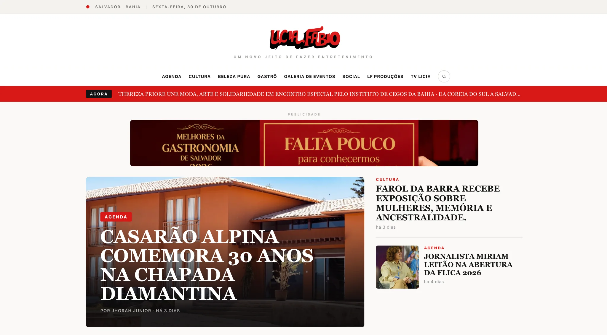
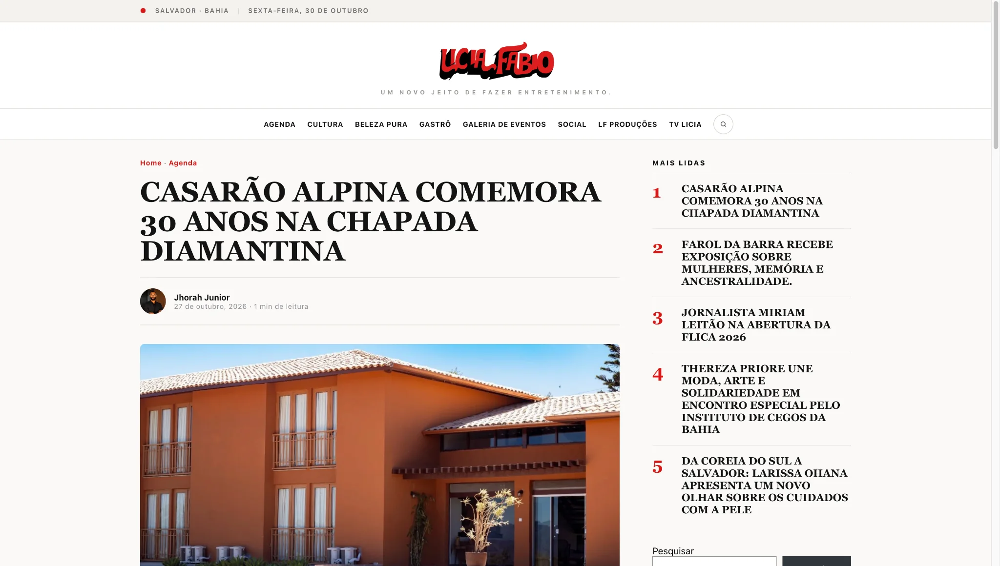
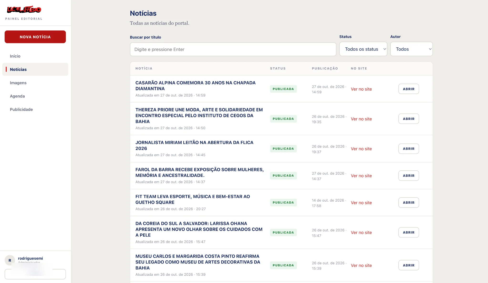
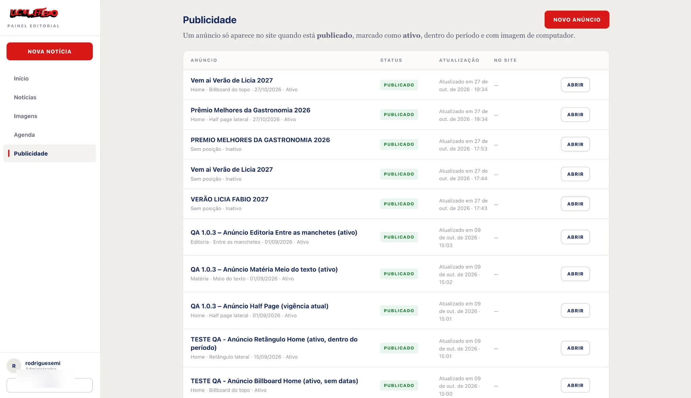
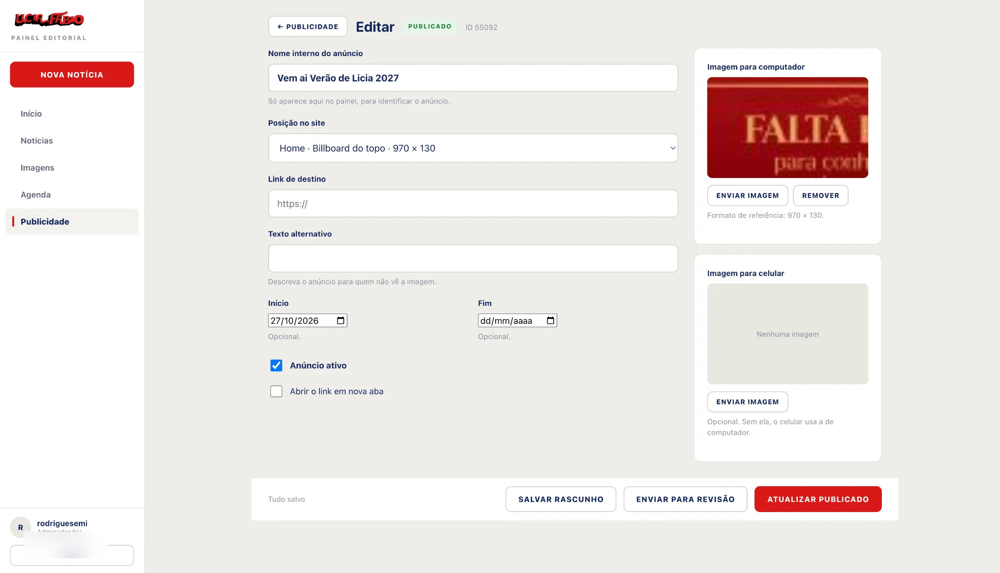
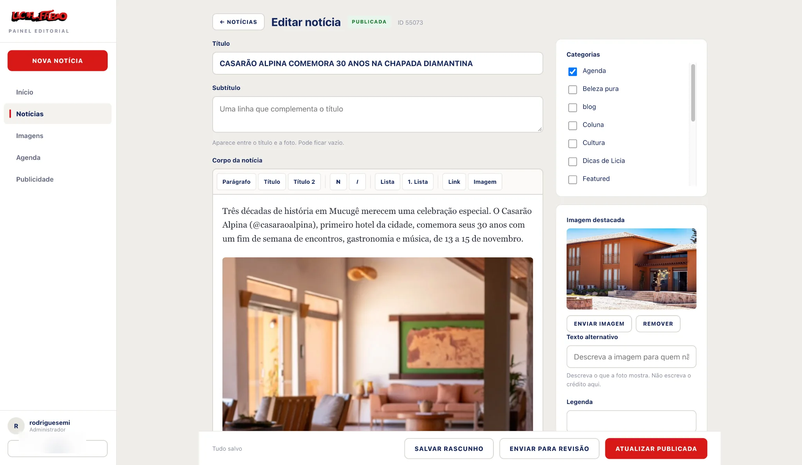

<div align="center">

[🇺🇸 English](./README.md) · [🇧🇷 Português](./README.pt-BR.md) · **🇪🇸 Español**

# Lícia Fábio — Portal de noticias y plataforma editorial

**Portal WordPress personalizado con un panel editorial integrado.**

[Sitio web](https://liciafabio.com.br/) · [Desarrollador](https://github.com/marcuscastrodev)

</div>

> **Nota sobre las versiones:** los componentes de este repositorio se identifican como `staging`. Son versiones del proyecto, no evidencia de un despliegue completo o auditoría de seguridad en producción.

## Resumen

Plataforma modular con portal público, panel editorial propio y una capa de datos reutilizable. La lógica de contenidos y los flujos editoriales residen en plugins WordPress separados del tema.

## Galería de interfaces

### Experiencia pública

Portada, secciones por categoría, artículos de escritorio y lectura móvil.

**01 — Home**



**02 — Secciones editoriales**


**03 — Artículo escritorio**



**04 — Artículo móvil**


### Panel editorial personalizado

Gestión de noticias, anúncios, edição de publicidade e matérias.

**05 — Gestión de noticias**



**06 — Gestión de publicidad**



**07 — Editor de anuncios**



**08 — Editor de noticias**



## Qué desarrollé

### 1. Portal público

Tema WordPress con portada, artículos, categorías, archivos, búsqueda, agenda y páginas de error, además de navegación responsiva, galerías, publicidad y contenido relacionado.

[Código del tema](wordpress-theme/)

### 2. Panel editorial

Interfaz propia en `/redacao/` integrada con WordPress. Permite gestionar noticias, agenda, anuncios y medios sin depender de las pantallas predeterminadas de wp-admin.

Incluye autenticación nativa de WordPress, permisos por capacidades, API REST, control de revisiones, bloqueo por elemento y recuperación de borradores.

**Limitación:** la protección de ediciones simultáneas se aplica entre sesiones del panel, pero ediciones externas desde wp-admin u otras integraciones pueden sobrescribir datos.

[Plugin editorial](editorial-plugin/)

### 3. Core editorial reutilizable

Plugin para tipos de contenido personalizados (`lf_evento` e `lf_anuncio`), metadatos, noticias destacadas, eventos, espacios publicitarios y campos REST con validación de permisos.

[Plugin Core](core-plugin/)

## Arquitectura

```text
WordPress
  ├── Tema: portal público
  ├── Plugin: panel editorial
  └── Plugin Core: datos, metadatos, eventos y anuncios
```

La autenticación y autorización usan los mecanismos nativos de WordPress.

## Stack

**Backend:** PHP · WordPress · WordPress REST API  
**Frontend:** HTML · CSS · JavaScript · diseño responsivo  
**Contenido:** tipos de contenido, metadatos, medios y plantillas  
**Integração:** autenticação e permissões nativas WordPress

## Estructura del repositorio

- `wordpress-theme/`: tema público
- `editorial-plugin/`: panel editorial
- `core-plugin/`: modelos y APIs compartidas
- `screenshots/`: galería

## Versiones de origen

| Componente | Versión |
| --- | --- |
| Tema | `1.0.5-staging` |
| Plugin editorial | `1.0.5-staging` |
| Plugin Core | `1.0.3-staging` |

## Ejecución local

Usa un entorno WordPress de desarrollo o staging. Las cabeceras indican WordPress **5.9+** e PHP **7.4+**; comprueba también las dependencias.

1. Copia `core-plugin/` para `wp-content/plugins/licia-fabio-core/`.
2. Copie `editorial-plugin/` para `wp-content/plugins/licia-fabio-editorial/`.
3. Copie `wordpress-theme/` para `wp-content/themes/licia-fabio/`.
4. Activa primero Core, después el panel y finalmente el tema.
5. Configura secciones y enlaces permanentes; verifica permisos, API y publicación.

**No instales estas versiones staging en producción sin pruebas y una revisión de seguridad.** El repositorio no incluye base de datos, medios ni credenciales.

## Decisiones de ingeniería

- **Separación de responsabilidades:** datos y lógica en el plugin, presentación en el tema.
- **Seguridad nativa:** sesiones WordPress y comprobaciones de capacidades.
- **Conflictos explícitos:** revisión y rechazo de modificaciones concurrentes entre sesiones del panel.
- **Compatibilidad:** medidas para conservar metadatos antiguos durante las migraciones.

## Documentación técnica

[Core](core-plugin/README.md) · [Painel editorial](editorial-plugin/README.md) · [Tema](wordpress-theme/)

---

Desarrollado por [Marcus Castro](https://github.com/marcuscastrodev).
