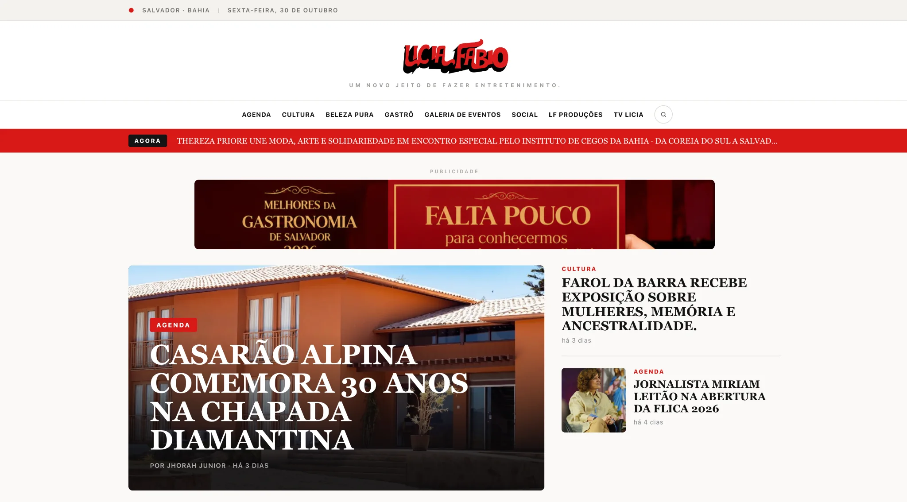
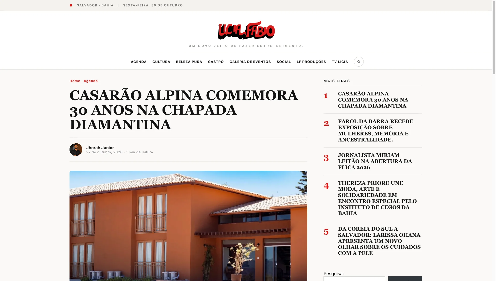
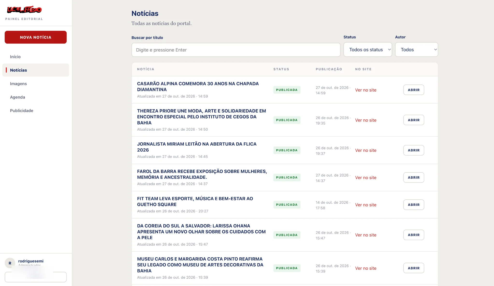
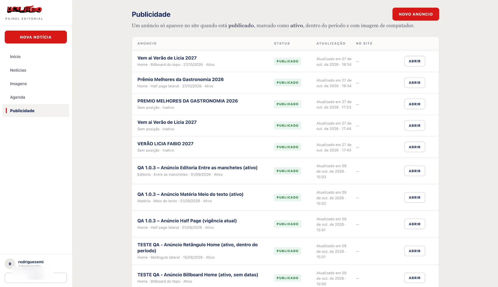
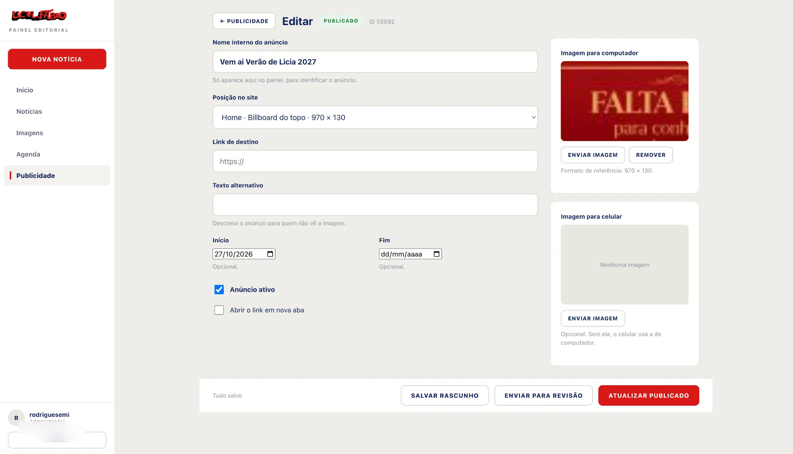
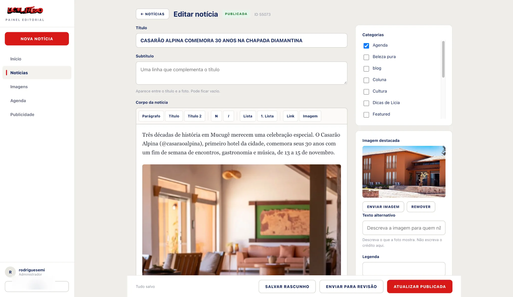

<div align="center">

[🇺🇸 English](./README.md) · **🇧🇷 Português** · [🇪🇸 Español](./README.es.md)

# Lícia Fábio — Portal de notícias e plataforma editorial

**Portal WordPress personalizado com painel de redação integrado.**

[Site publicado](https://liciafabio.com.br/) · [Desenvolvedor](https://github.com/marcuscastrodev)

</div>

> **Nota sobre as versões:** os componentes disponíveis neste repositório estão identificados como `staging`. São versões do projeto, mas não representam comprovação de deploy integral ou auditoria de segurança em produção.

## Visão geral

Plataforma modular com portal público, painel editorial próprio e uma camada reutilizável de dados. Regras de conteúdo e fluxos de trabalho residem em plugins WordPress separados do tema.

## Galeria de interfaces

### Experiência pública

Home, seções por categoria, artigo desktop e leitura mobile.

**01 — Home**



**02 — Seções editoriais**


**03 — Artigo desktop**



**04 — Artigo mobile**


### Painel editorial personalizado

Gestão de notícias, anúncios, edição de publicidade e matérias.

**05 — Gestão de notícias**



**06 — Gestão de publicidade**



**07 — Editor de anúncios**



**08 — Editor de notícias**



## O que desenvolvi

### 1. Portal público

Tema WordPress com Home, matérias, categorias, arquivos, busca, agenda e páginas de erro, além de navegação responsiva, galerias, publicidade e conteúdo relacionado.

[Código do tema](wordpress-theme/)

### 2. Painel editorial

Interface própria em `/redacao/` integrada ao WordPress. Permite editar notícias, agenda, anúncios e mídia sem depender diretamente das telas padrão do wp-admin.

Inclui autenticação nativa do WordPress, permissões por capacidade, REST API, verificação de revisões, bloqueio por item e recuperação de rascunhos.

**Limitação:** proteções contra edições simultâneas se aplicam às sessões do painel, mas mudanças externas feitas no wp-admin ou outras integrações ainda podem sobrescrever dados.

[Plugin editorial](editorial-plugin/)

### 3. Core editorial reutilizável

Plugin para tipos de conteúdo personalizados (`lf_evento` e `lf_anuncio`), metadados, notícias em destaque, eventos, espaços publicitários e campos REST com validações de permissão.

[Plugin Core](core-plugin/)

## Arquitetura

```text
WordPress
  ├── Tema: portal público
  ├── Plugin: painel editorial
  └── Plugin Core: dados, metadados, eventos e anúncios
```

A autenticação e a autorização utilizam os mecanismos nativos do WordPress.

## Stack

**Backend:** PHP · WordPress · WordPress REST API  
**Frontend:** HTML · CSS · JavaScript · responsividade  
**Conteúdo:** post types, metadados, mídias e templates  
**Integração:** autenticação e permissões nativas WordPress

## Estrutura do repositório

- `wordpress-theme/`: tema público
- `editorial-plugin/`: painel de redação
- `core-plugin/`: modelos e APIs compartilhados
- `screenshots/`: galeria

## Versões de origem

| Componente | Versão |
| --- | --- |
| Tema | `1.0.5-staging` |
| Plugin editorial | `1.0.5-staging` |
| Plugin Core | `1.0.3-staging` |

## Execução local

Use um ambiente WordPress de desenvolvimento ou staging. Os cabeçalhos indicam WordPress **5.9+** e PHP **7.4+**; confirme também as dependências.

1. Copie `core-plugin/` para `wp-content/plugins/licia-fabio-core/`.
2. Copie `editorial-plugin/` para `wp-content/plugins/licia-fabio-editorial/`.
3. Copie `wordpress-theme/` para `wp-content/themes/licia-fabio/`.
4. Ative o Core, depois o painel e então o tema.
5. Configure seções e links permanentes; teste permissões, API e publicação.

**Não instale essas versões staging em produção sem testes e revisão de segurança.** O repositório não inclui banco de dados, mídias ou credenciais.

## Decisões de engenharia

- **Separação de responsabilidades:** dados e regras no plugin, apresentação no tema.
- **Segurança nativa:** sessões WordPress e verificações de capacidade.
- **Conflitos explícitos:** revisão e rejeição de alterações concorrentes entre sessões do painel.
- **Compatibilidade:** cuidados para preservar metadados legados durante migrações.

## Documentação técnica

[Core](core-plugin/README.md) · [Painel editorial](editorial-plugin/README.md) · [Tema](wordpress-theme/)

---

Desenvolvido por [Marcus Castro](https://github.com/marcuscastrodev).
